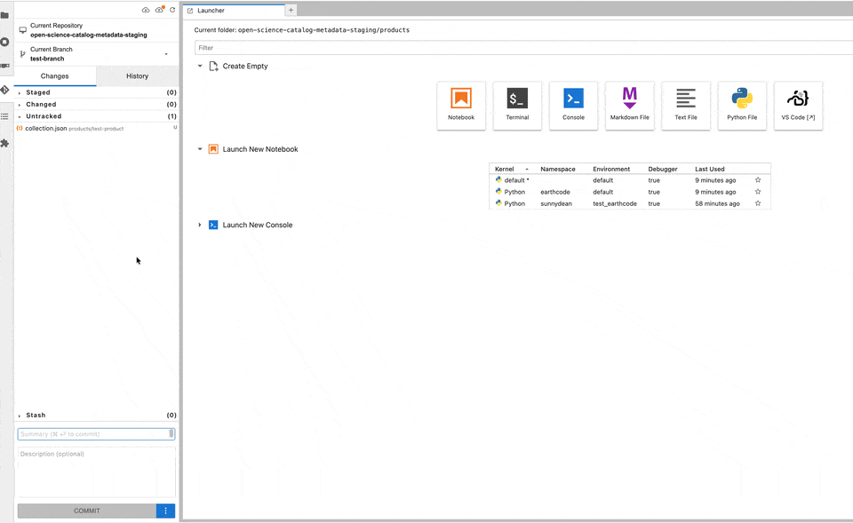
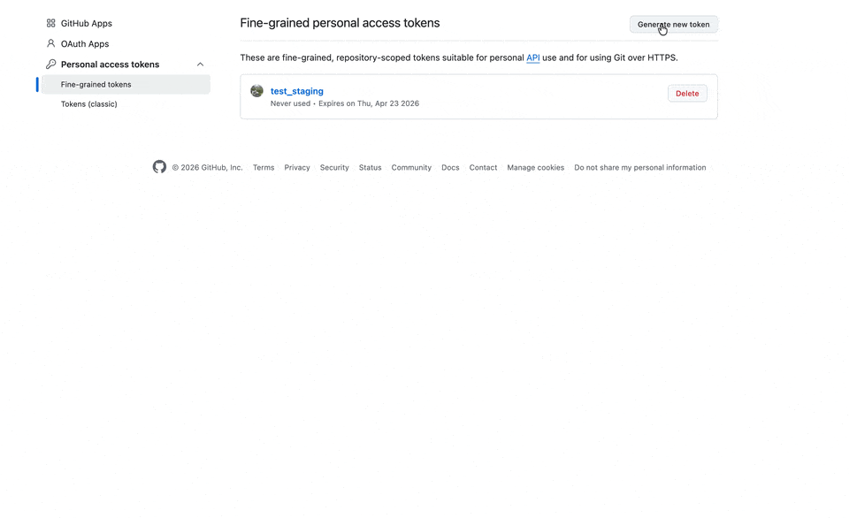

# Contributing Code During the Ocean Hackathon

Please add your hackathon work under `5_Hackathon_Code/`.

## Open the Repository

The EDC workspace git-puller link is:

https://workspace.ocean-hackathon.hub-otc-sc.eox.at/hub/user-redirect/git-pull?repo=https%3A%2F%2Fgithub.com%2FESA-EarthCODE%2Focean_hackathon&urlpath=lab%2Ftree%2Focean_hackathon%2F0_Introduction%2Fintro.ipynb&branch=main

This link will clone the repository if it is not already available in your workspace and open the introductory notebook.

The main Ocean Hackathon repository is:

https://github.com/ESA-EarthCODE/ocean_hackathon

## Fork the Repository

After the repository is open in your workspace, create your own fork of the main repository on GitHub. Your fork will look like:

```text
https://github.com/<your-github-username>/ocean_hackathon
```

[GitHub Docs: Fork a repository](https://docs.github.com/en/pull-requests/collaborating-with-pull-requests/working-with-forks/fork-a-repo)

Then change the local workspace repository so `origin` points to your fork:

```bash
git remote -v
git remote set-url origin https://github.com/<your-github-username>/ocean_hackathon.git
git remote -v
```

Keep the main hackathon repository as `upstream` so you can pull updates:

```bash
git remote add upstream https://github.com/ESA-EarthCODE/ocean_hackathon.git
```

If `upstream` already exists, skip that line.

[GitHub Docs: Managing remote repositories](https://docs.github.com/en/get-started/git-basics/managing-remote-repositories)


## Commit Your Work

Run these commands in a terminal, not inside a notebook:

```bash
git switch -c <branch-name>
git status
git add 5_Hackathon_Code/
git commit -m "Add hackathon contribution"
git push origin <branch-name>
```

Choose a short branch name that describes your work, for example `add-ocean-analysis-notebook`. Your changes are pushed to your fork, not to the main hackathon repository.

[GitHub Docs: Set up Git](https://docs.github.com/en/get-started/git-basics/set-up-git)

[GitHub Docs: Pushing commits to a remote repository](https://docs.github.com/en/get-started/using-git/pushing-commits-to-a-remote-repository)

You can also commit using JupyterLab's Git panel:




## GitHub Authentication

You'll be asked for a token; you can generate a personal access token for GitHub, the example below shows how to create one.




## Open a Pull Request

Open a pull request from your fork's branch into the main Ocean Hackathon repository:

https://github.com/ESA-EarthCODE/ocean_hackathon/pulls

[GitHub Docs: Creating a pull request](https://docs.github.com/en/pull-requests/collaborating-with-pull-requests/proposing-changes-to-your-work-with-pull-requests/creating-a-pull-request)

After creating the pull request, check that it appears in the pull request list and follow up on any review comments.
